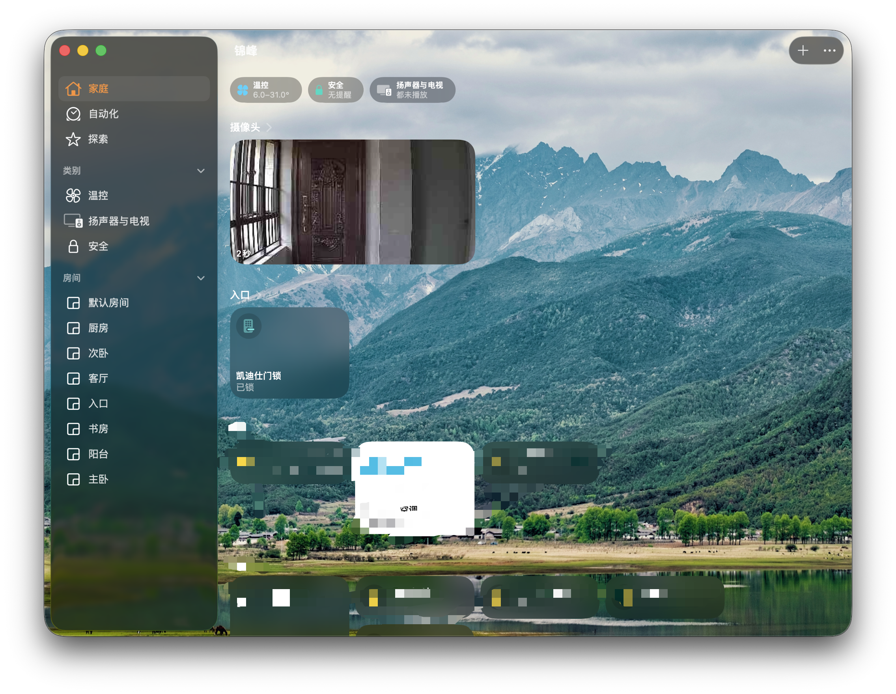
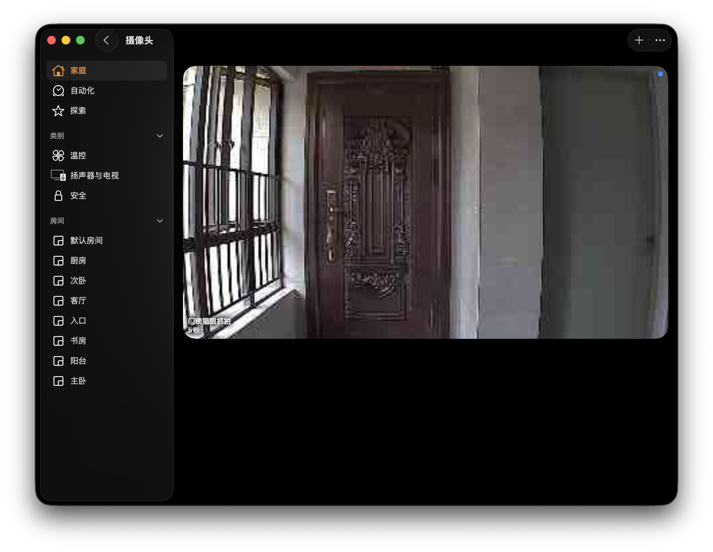
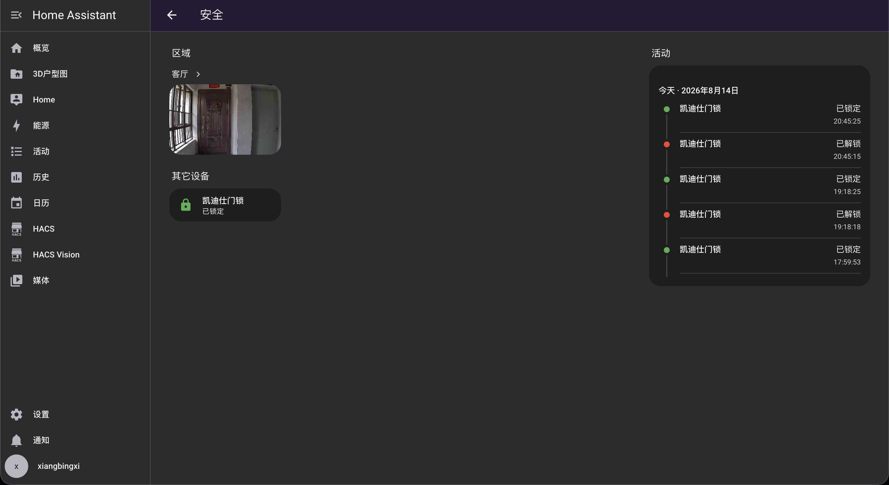
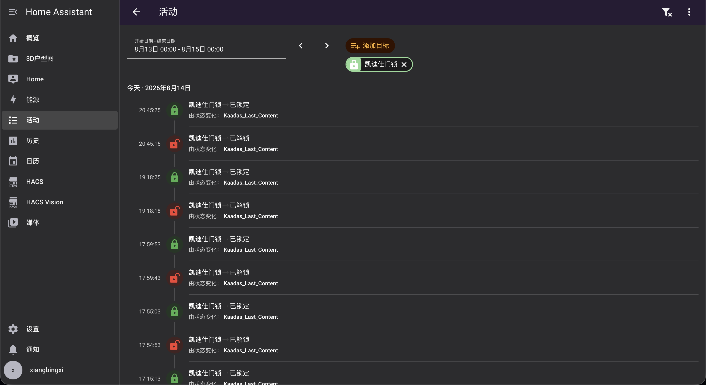
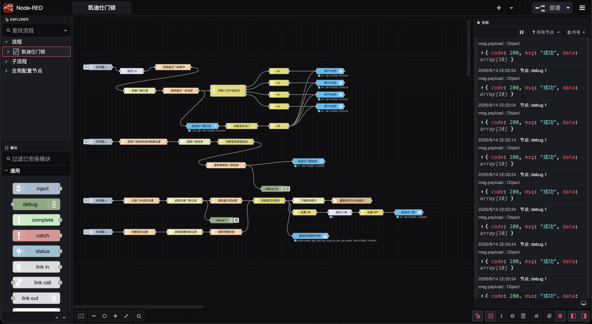

# 凯迪仕智能门锁接入 Home Assistant & Apple HomeKit (Node-RED)

[](https://opensource.org/licenses/MIT)
[](https://nodered.org/)
[](https://www.home-assistant.io/)
[](https://www.fnnas.com/)

[**English Documentation**](./README_EN.md)

---

通过 Node-RED 轮询凯迪仕云端 API，将凯迪仕智能门锁接入 Home Assistant，并可进一步桥接至 Apple HomeKit，实现门锁事件监控、开锁用户编号识别、电池电量监测、访客门铃抓拍、安全预警抓拍，以及 Apple 设备原生门铃通知等功能。

本项目通过 Node-RED 获取凯迪仕云端门锁事件和设备信息，再将相关数据转换为 Home Assistant 实体，并结合本地图片缓存、摄像头实体及 HomeKit Bridge，实现智能门锁与家庭自动化平台之间的联动。

> 💡 **特别说明**
>
> 1. 本项目方案基于 Docker 容器化部署，最初在飞牛 OS（fnOS）环境下配置。
> 2. 当前已实际测试的门锁型号为 **凯迪仕 K20 Pro Max**。其他型号的云端接口、字段和数据结构可能存在差异，尚不能保证其他型号可以直接使用。
> 3. 凯迪仕云端 API 的请求参数、认证方式及返回数据结构可能随 App 版本、设备型号或服务端调整而变化，具体内容请以个人实际抓包结果为准。
> 4. 抓拍图片的本地保存路径（如 `/config/www/lock_latest.jpg`）需要根据 Node-RED 与 Home Assistant 的实际目录挂载关系进行调整。
> 5. **HomeKit 桥接为可选功能。** 如果只需要在 Home Assistant 内查看门锁状态、事件、电量和抓拍图片，不需要配置 HomeKit Bridge。
> 6. 本项目依赖凯迪仕云端接口，不等同于直接通过局域网控制门锁。云端接口、网络连接或认证信息发生变化时，部分功能可能受到影响。

---

## 🧪 实际测试环境

以下为目前已经实际验证的软硬件环境：

| 项目 | 实际测试环境 |
| :--- | :--- |
| 智能门锁 | 凯迪仕 K20 Pro Max |
| Home Assistant 安装方式 | Home Assistant Container |
| Home Assistant Core | 2026.8.1 |
| Home Assistant Frontend | 20260729.6 |
| Node-RED | 5.0.4 |
| Node-RED 部署方式 | Docker 容器 |

以上环境是目前已验证的配置，不代表其他门锁型号、Home Assistant 版本或 Node-RED 版本均已完成测试。

### 已验证功能

- **门锁事件通知**：每次发生开锁或上锁相关事件时，均可触发对应的事件处理与通知流程。
- **开锁用户编号识别**：能够获取与指纹、人脸等开锁凭据对应的用户编号。
- **用户编号稳定性**：同一开锁凭据重复触发开锁事件时，返回的用户编号保持一致；不同开锁凭据可以对应不同编号。
- **电池电量更新**：门锁电池剩余电量能够更新至 Home Assistant。
- **门铃抓拍更新**：访客按门铃后，抓拍图片能够更新至 Home Assistant。
- **HomeKit 图片同步**：完成相应的 HomeKit 配置后，门铃抓拍图片能够同步用于 Apple 家庭中的相关展示。

> **关于用户编号：** 本项目获取的是门锁接口返回的用户编号或凭据标识。编号对应的是门锁中配置的开锁凭据，并不直接代表某个人的真实姓名。若需要区分家庭成员，请根据自己在门锁中设置的指纹、人脸或其他凭据进行对应。

---

## 📸 效果展示

### 1. Apple HomeKit 原生联动与抓拍（可选）

| Apple 家庭 App 概览 | 猫眼抓拍大图界面 |
| :---: | :---: |
|  |  |
| *图 1：Apple 家庭首页展示门锁状态与猫眼微缩快照* | *图 2：点击后查看猫眼抓拍大图，图片可通过流程进行旋转校正* |

---

### 2. Home Assistant 仪表盘与活动日志

| HA 安全区域面板 | 门锁实时活动日志 |
| :---: | :---: |
|  |  |
| *图 3：Home Assistant 仪表盘整合门锁状态与最新抓拍* | *图 4：记录门锁事件及相关状态信息* |

---

### 3. Node-RED 自动化拓扑全貌



*图 5：包含门锁操作日志、设备与电量信息、门铃与预警抓拍等功能的 Node-RED 流程配置。实际启用的功能以导入的流程及个人配置为准。*

---

## 🌟 致谢与参考

本项目的基础门锁状态轮询与电量读取思路参考了以下开源项目与社区讨论：

- GitHub 仓库：[MF-142/kaadas](https://github.com/MF-142/kaadas)
- 瀚思彼岸讨论帖：[接入凯迪仕智能锁（node-red）- 瀚思彼岸论坛](https://bbs.hassbian.com/thread-24121-1-1.html)

在相关思路的基础上，本项目进一步整合了门锁事件处理、抓拍图片下载与本地缓存，以及 Home Assistant 和 Apple HomeKit 联动功能。

主要扩展内容包括：

1. **猫眼访客抓拍支持**：捕获访客按门铃时的抓拍图片，并下载至本地缓存。
2. **异常报警抓拍支持**：流程可处理云端返回的异常报警抓拍信息，例如连续验证失败或防撬相关报警；具体支持范围取决于接口实际返回的数据。
3. **阿里云 OSS 图像旋转校正**：通过图片处理参数旋转抓拍图片，改善因门锁摄像头安装方向导致的图片横向或倒置问题。
4. **Apple HomeKit 联动**：通过 Home Assistant 摄像头、门铃相关实体及 HomeKit Bridge，将相关信息同步至 Apple 家庭。

---

## ✨ 核心特性

- 🚪 **门锁事件与日志记录**：获取门锁事件并同步至 Home Assistant，可根据云端返回的信息识别开锁方式及对应用户编号。
- 👤 **开锁凭据编号识别**：根据门锁接口返回的用户编号区分不同开锁凭据。同一凭据在重复开锁事件中能够保持编号一致。
- 🔋 **设备与电量监测**：获取门锁电池剩余电量及接口返回的其他设备信息，并同步至 Home Assistant。
- 🔔 **门铃抓拍自动更新**：访客按门铃后，流程获取云端抓拍图片并更新本地缓存。
- 🖼️ **抓拍图片旋转校正**：可利用阿里云 OSS 图片处理参数修正图片方向。
- 🚨 **安全异常事件处理**：流程可处理接口返回的异常报警信息，并按配置执行对应抓拍或通知操作。
- 🏠 **Home Assistant 集成**：通过 Node-RED 与 Home Assistant 实体节点，将门锁事件、设备状态和抓拍信息接入自动化流程。
- 🍎 **Apple HomeKit 联动（可选）**：可通过 HomeKit Bridge 同步相关实体，让 Apple 家庭显示门铃或摄像头相关信息。

> 注意：门锁事件、用户编号、电量更新、门铃抓拍更新以及配置后的 HomeKit 图片同步，已在上文所列测试环境中实际验证。具体异常报警类型、通知设备表现及其他型号兼容性，请以实际接口返回与测试结果为准。

---

## 🛠️ 前置准备

在开始部署之前，请准备以下环境：

- 已正常运行的 Home Assistant。
- 已运行的 Node-RED 实例。
- 可以正常访问凯迪仕云端服务的网络环境。
- 用于获取凯迪仕 App 请求参数的抓包工具。
- 如果需要使用 Apple 家庭功能，还需要配置 HomeKit Bridge。
- 如果需要显示门铃抓拍图片，需要确保 Node-RED 能够将图片写入 Home Assistant 可访问的目录。

### 1. Home Assistant 配置

#### 1.1 安装 Node-RED Companion

1. 在 HACS 中搜索并安装 `Node-RED Companion` 集成。
2. 安装完成后，进入 **设置 → 设备与服务**。
3. 添加并启用对应集成。
4. 确认 Node-RED 中的 Home Assistant 节点已正确连接到 Home Assistant。

> 不同版本的 Node-RED、Home Assistant 及相关节点包，界面和配置方式可能有所区别。请根据实际安装版本完成连接配置。

#### 1.2 配置通用摄像头（Generic Camera）

如果需要将本地抓拍图片作为 Home Assistant 摄像头显示，可以在 `configuration.yaml` 中配置通用摄像头，或通过 Home Assistant 支持的集成配置界面添加。

示例：

```yaml
camera:
  - platform: generic
    name: "门锁猫眼抓拍"
    still_image_url: "http://127.0.0.1:8123/local/lock_latest.jpg"
    verify_ssl: false
```

**请根据实际环境调整：**

- `/local/lock_latest.jpg` 对应 Home Assistant 配置目录下 `www/lock_latest.jpg`。
- Home Assistant 需要能够访问该文件。
- `127.0.0.1` 只表示访问该地址的当前网络命名空间。在 Docker 环境中，如果 Node-RED 与 Home Assistant 位于不同容器，不能直接假定两者的 `127.0.0.1` 指向同一个容器。
- 如果需要从其他容器或设备访问 Home Assistant，请根据实际网络配置使用正确的主机地址或服务地址。
- 不同版本的 Home Assistant 对摄像头平台配置方式可能存在差异，请以当前版本支持的配置方式为准。

配置完成后，检查 Home Assistant 是否能够正常加载抓拍图片。

#### 1.3 配置 HomeKit Bridge（可选）

> 如果不需要将门锁接入 Apple 家庭，可以跳过此步骤。

1. 进入 Home Assistant 的 **设置 → 设备与服务**。
2. 添加或打开 `HomeKit Bridge`。
3. 根据实际实体配置，将门铃相关实体和摄像头实体纳入桥接范围。
4. 按照 Home Assistant 提供的配对流程，将桥接添加至 Apple 家庭。

原有流程中涉及的实体示例：

- 门铃相关实体：`binary_sensor.kaadas_doorbell`
- 抓拍摄像头实体：`camera.men_suo_mao_yan_zhua_pai`

上述实体 ID 仅为示例。**请使用自己 Home Assistant 中实际存在的实体 ID**，并确认实体类型、状态及 HomeKit Bridge 支持情况。

如果需要使用 HomeKit 的门铃或摄像头展示，还应检查 Home Assistant 中的实体状态是否能够正常变化，以及图片 URL 是否能够被正确访问。

---

### 2. 目录映射与保存路径（以飞牛 fnOS / Docker 为例）

Node-RED 下载的抓拍图片需要写入 Home Assistant 能够读取的本地目录，即 Home Assistant 配置目录下的 `www` 文件夹。

以以下目录结构为例：

| 项目 | 示例路径 |
| :--- | :--- |
| Home Assistant 宿主机配置目录 | `/vol1/1000/docker/homeassistant/config` |
| Home Assistant 图片目录 | `/vol1/1000/docker/homeassistant/config/www` |
| Node-RED 容器内目标路径 | `/config/www/lock_latest.jpg` |
| Home Assistant 本地图片访问路径 | `/local/lock_latest.jpg` |

上述路径以示例环境为准，部署时应根据自己的 Docker 挂载配置调整。

#### 目录映射要求

- Home Assistant 的配置目录中应存在 `www` 文件夹。
- Node-RED 必须能够写入图片保存目录。
- 如果 Node-RED 与 Home Assistant 运行在不同的 Docker 容器中，应确保 Node-RED 能够通过共享卷或其他适当方式访问该目录。
- 如果两个容器没有共享目录，Node-RED 写入自己容器内的 `/config/www`，并不意味着 Home Assistant 能读取同一文件。

在 Node-RED 的 `覆盖保存为本地图片` 节点中，默认写入路径为：

```text
/config/www/lock_latest.jpg
```

请根据实际挂载映射关系按需调整。

> **重要：** 如果图片无法显示，请先检查图片文件是否确实写入了 Home Assistant 的 `www` 目录，再检查 Home Assistant 摄像头 URL 和容器网络配置。

---

### 3. 抓包获取凯迪仕凭据

本项目需要使用凯迪仕 App 请求中的相关参数访问云端接口。可以使用支持 HTTPS 抓包的工具，例如 iOS 上的 Stream、Thor，或电脑端的 Charles、mitmproxy 等。

具体操作取决于 App 的网络请求方式、证书验证机制以及当前接口实现。请在自己有权访问的设备和账号上进行操作。

需要关注的三个核心参数如下：

| 参数 | 用途 | 说明 |
| :--- | :--- | :--- |
| `token` | 请求认证 | 通常为请求头或请求参数中的认证凭据 |
| `wifiSN` | 门锁标识 | 用于定位对应的门锁设备 |
| `uid` | 用户账号标识 | 用于部分设备信息请求 |

以上参数名称和具体位置应以实际抓包结果为准。

**安全注意事项：**

- `token`、`uid` 和设备序列号可能涉及个人账号或设备安全信息。
- 不要将真实凭据提交到公开 GitHub 仓库。
- 不要在公开截图、日志或问题反馈中暴露完整认证信息。
- 分享流程模板时，应使用占位符替代个人凭据。
- 如果怀疑认证凭据泄露，应根据服务实际支持的方式重新获取或更新凭据。

---

## 🚀 部署步骤

### 1. 导入流程

1. 下载本仓库中的 [`flows-template.json`](./flows-template.json)。
2. 打开 Node-RED 编辑器。
3. 点击右上角菜单，选择 **导入（Import）**。
4. 选择并上传下载的 JSON 文件。
5. 检查导入后的节点、连线以及相关配置。

建议在导入前备份已有的 Node-RED 流程，以便出现问题时恢复。

### 2. 填入个人凭据

在导入的流程中，找到对应节点，将模板中的占位符替换为自己实际抓包获取的参数。

| Node-RED 节点 | 需要配置的参数 |
| :--- | :--- |
| `获取最近门锁事件` | `YOUR_KAADAS_TOKEN`、`YOUR_LOCK_WIFI_SN` |
| `获取门锁信息请求数据设置` | `YOUR_KAADAS_TOKEN`、`YOUR_KAADAS_UID` |
| `访客门铃请求设置` | `YOUR_KAADAS_TOKEN`、`YOUR_LOCK_WIFI_SN` |
| `预警请求设置` | `YOUR_KAADAS_TOKEN`、`YOUR_LOCK_WIFI_SN` |
| `推送抓拍图到手机`（可选） | `YOUR_HA_NOTIFY_SERVICE` |

例如，手机通知服务名称可能类似于：

```text
notify.mobile_app_iphone
```

具体服务名称请以自己的 Home Assistant 实际配置为准。部分流程模板可能要求填写服务名称本身，而非完整服务路径，请以节点中的字段和说明为准。

**请注意：** 不同版本的流程模板可能具有不同的节点字段。若节点名称或参数与本文不同，请以当前仓库中的 `flows-template.json` 为准，不要直接照搬不匹配的字段。

### 3. 连接 Home Assistant

1. 双击流程中的 Home Assistant 实体节点，例如 `凯迪仕门铃`。
2. 在 Server 配置中选择或创建 Home Assistant 服务器连接。
3. 填入 Home Assistant 的实际地址。
4. 根据节点要求填写长期访问令牌（Long-Lived Access Token）。
5. 保存后检查连接状态。

如果 Node-RED 与 Home Assistant 位于不同的 Docker 容器中，请使用 Node-RED 容器能够访问的 Home Assistant 地址，不要默认使用 `127.0.0.1`。

长期访问令牌具有访问权限，应当妥善保管，不要提交到公开仓库或公开日志中。

### 4. 检查本地图片保存

如果启用了门铃抓拍功能，请确认：

1. Home Assistant 配置目录下存在 `www` 文件夹。
2. Node-RED 可以写入图片目标路径。
3. 抓拍流程执行后，目标文件 `lock_latest.jpg` 能够正常创建或更新。
4. Home Assistant 能够通过 `/local/lock_latest.jpg` 访问图片。
5. 如果启用了 HomeKit，确认 HomeKit 桥接使用的摄像头实体可以正常读取图片。

### 5. 部署上线

完成参数配置后：

1. 点击 Node-RED 右上角的 **部署（Deploy）**。
2. 检查 Home Assistant 节点的连接状态。
3. 查看 Node-RED 调试面板及运行日志。
4. 触发一次门锁事件，检查事件是否能被正确获取。
5. 测试门铃抓拍、电量更新以及其他已配置功能。

节点显示绿色 `connected` 通常表示相关连接已建立，但不代表所有云端请求、图片处理和实体更新都已成功。仍需通过实际事件进行验证。

---

## 🏗️ 运行流程架构


以下为主要处理逻辑的示意，具体节点、连线和执行顺序以仓库中的 `flows-template.json` 为准。

```text
┌──────────────────────────────────────────────────────────────┐
│                    门锁事件与设备信息                         │
│                                                              │
│  [获取最近门锁事件] ──► [解析门锁事件] ──► [更新 HA 实体]      │
│                                                              │
│  [获取门锁信息] ──────► [解析设备信息] ──► [更新电量等状态]    │
└──────────────────────────────────────────────────────────────┘


┌──────────────────────────────────────────────────────────────┐
│                     门铃与预警抓拍                             │
│                                                              │
│  [访客门铃 /visit] ──► [提取访客抓拍] ──┐                     │
│                                         ├─► [判断是否有图片]  │
│  [异常报警 /alarm] ──► [提取预警抓拍] ──┘                     │
│                                                              │
│                            ▼                                 │
│                  [下载抓拍图片]                               │
│                            ▼                                 │
│                [OSS 图片旋转处理]                             │
│                            ▼                                 │
│        [覆盖保存为 /config/www/lock_latest.jpg]               │
│                            ▼                                 │
│                  [更新 HA 摄像头展示]                         │
│                            ▼                                 │
│               [HomeKit 联动（可选）]                          │
└──────────────────────────────────────────────────────────────┘
```

### 门铃与抓拍处理说明

1. 流程获取云端返回的访客门铃或预警事件。
2. 从响应数据中提取可用的抓拍图片信息。
3. 下载图片，并根据配置进行必要的图片处理。
4. 将图片保存到 Home Assistant 可以访问的本地目录。
5. Home Assistant 摄像头实体读取更新后的图片。
6. 如果配置了 HomeKit Bridge，相关摄像头或门铃实体可进一步同步至 Apple 家庭。

图片处理、通知及 HomeKit 展示是否能够成功，取决于接口响应、文件访问权限、实体配置和相关平台的实际行为。

---

## 🔍 功能验证清单

部署完成后，可以按照以下清单逐项检查。

- [ ] Node-RED 能够连接 Home Assistant。
- [ ] 凯迪仕云端请求能够正常返回数据。
- [ ] 门锁发生开锁或上锁相关事件时，流程能够获取并处理事件。
- [ ] Home Assistant 中对应的门锁状态或日志能够正常更新。
- [ ] 不同开锁凭据能够返回相应的用户编号。
- [ ] 同一开锁凭据重复触发时，返回的用户编号保持一致。
- [ ] 门锁电池电量能够正常更新。
- [ ] 访客按门铃后，流程能够获取抓拍图片。
- [ ] 抓拍图片能够写入 Home Assistant 的 `www` 目录。
- [ ] Home Assistant 摄像头实体能够读取最新图片。
- [ ] 如果启用了 HomeKit，Apple 家庭能够正常显示已桥接的实体。
- [ ] 如果启用了手机通知，通知服务能够正常触发。

以上项目并非全部为强制条件。是否需要完成 HomeKit、手机通知或预警抓拍测试，取决于个人实际启用的功能。

---

## 🧩 常见问题排查

### 1. Node-RED 无法连接 Home Assistant

请检查：

- Home Assistant 是否正常运行。
- Node-RED 是否能够访问 Home Assistant 的网络地址。
- Server 配置中的地址、端口和长期访问令牌是否正确。
- 相关 Home Assistant 节点是否已正确安装和配置。

Docker 容器之间的 `127.0.0.1` 通常指向当前容器本身，而不是另一个容器。请根据实际网络结构配置连接地址。

### 2. 门锁事件没有更新

请检查：

- `token` 是否有效。
- `wifiSN` 是否对应正确的门锁。
- 请求参数是否与实际抓包结果一致。
- 云端接口是否正常返回数据。
- Node-RED 调试面板中是否出现请求失败或解析错误。

云端接口可能随 App 版本或服务端变化而调整，因此不要假定所有型号都使用完全相同的请求格式。

### 3. 用户编号无法正确识别

请检查：

- 返回数据中是否包含用户编号或凭据标识。
- 当前流程是否正确提取该字段。
- 不同开锁事件的响应结构是否存在差异。

用户编号是门锁接口返回的标识，不一定直接对应实际使用者的姓名。具体含义应以设备接口数据和门锁中的凭据配置为准。

### 4. 电池电量没有更新

请检查：

- 设备信息请求是否成功。
- 返回数据中是否包含电量字段。
- Node-RED 是否正确解析该字段。
- 对应 Home Assistant 实体是否正常更新。

如果请求成功但实体没有变化，应进一步检查流程中的字段映射和实体更新节点。

### 5. 门铃抓拍图片无法显示

请检查：

- 门铃事件是否成功触发。
- 云端响应中是否包含有效的抓拍图片地址。
- 图片下载节点是否执行成功。
- Node-RED 是否具有目标目录的写入权限。
- 图片是否确实保存到了 Home Assistant 的 `www` 目录。
- 摄像头实体的图片 URL 是否正确。
- Docker 容器之间是否正确共享了图片目录。

### 6. 抓拍图片方向不正确

本项目的相关流程可以使用阿里云 OSS 图片处理参数旋转图片，例如：

```text
?x-oss-process=image/rotate,90
```

具体旋转角度应根据实际抓拍图片方向调整。请确认云端图片地址支持对应的图片处理方式；如果服务端不支持该参数，图片可能无法按预期旋转。

### 7. HomeKit 中没有显示门铃或抓拍图片

请检查：

- Home Assistant 中对应的实体是否存在。
- 摄像头实体能否正常显示图片。
- HomeKit Bridge 是否已配置并完成配对。
- 需要同步的实体是否包含在桥接范围内。
- 实体类型、状态及相关功能是否符合当前 Home Assistant 和 Apple 家庭的支持要求。

Home Assistant 中能够正常显示摄像头图片，并不意味着所有 HomeKit 设备或系统版本都会以完全相同的方式呈现门铃通知。

### 8. 其他型号是否可以使用？

目前实际验证的型号为 **凯迪仕 K20 Pro Max**。

其他型号可能在接口地址、字段名称、响应结构、凭据或抓拍方式方面存在差异。可以参考本项目的处理思路进行适配，但需要自行抓包并验证，不能保证直接导入即可运行。

---

## 🔐 安全与隐私

本项目涉及门锁云端接口、设备标识、认证凭据和家庭自动化信息。请注意：

- 不要公开真实的 `token`、`uid`、`wifiSN` 或长期访问令牌。
- 不要将包含个人凭据的 Node-RED 流程直接上传到公开仓库。
- 分享日志或调试截图前，应检查并遮盖敏感信息。
- 根据实际需要配置 Home Assistant、Node-RED 和 Docker 的访问权限。
- 使用前请了解凯迪仕云端接口及相关服务的隐私和安全风险。

本项目是社区性质的集成方案，不是凯迪仕官方提供的 Home Assistant 集成。使用者应自行确认配置是否适合自己的设备和网络环境。

---

## 📄 License

本项目采用 [MIT License](https://opensource.org/licenses/MIT) 开源协议。
